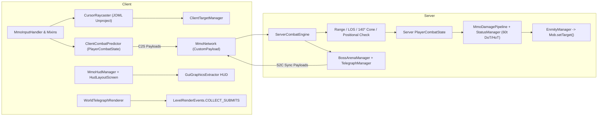

# ARCHITECTURE — XIV MMO (`xivmmo`) for Minecraft 26.2

## 1. Package Layout

### Common / Server (`src/main/java/net/xivmmo/`)
- [`XivMmoMod`](file:///c:/Users/Luigi/Documents/MinecraftMMO/src/main/java/net/xivmmo/XivMmoMod.java) — Common entrypoint registering data reload listeners, network payload codecs, and the server combat engine.
- `config/`:
  - [`MmoConfig`](file:///c:/Users/Luigi/Documents/MinecraftMMO/src/main/java/net/xivmmo/config/MmoConfig.java) — JSON-persisted configuration (`config/xivmmo.json`), per-world MMO overrides, vanilla hotbar UI/mechanics suppression flags, and normalized `WidgetLayout` anchors/scales for all 7 rearrangeable HUD widgets (`ACTION_HOTBAR`, `PLAYER_VITALS`, `CAST_BAR`, `TARGET_FRAME`, `FOCUS_TARGET`, `PARTY_LIST`, `COMBAT_TEXT`).
- `combat/ability/`:
  - [`AbilityDefinition`](file:///c:/Users/Luigi/Documents/MinecraftMMO/src/main/java/net/xivmmo/combat/ability/AbilityDefinition.java) — Immutable record & Mojang `Codec` for data-driven abilities (`GCD`/`OGCD`, cast time, recast, cooldown group, charges, mana cost, combo prerequisite/potency, positional bonus, AoE shape/radius/cone angle, status application).
  - [`JobDefinition`](file:///c:/Users/Luigi/Documents/MinecraftMMO/src/main/java/net/xivmmo/combat/ability/JobDefinition.java) — Immutable record & `Codec` for playable jobs (`TANK`, `HEALER`, `MELEE_DPS`, `RANGED_DPS`) and their 8-slot action bars.
- `combat/engine/`:
  - [`PlayerCombatState`](file:///c:/Users/Luigi/Documents/MinecraftMMO/src/main/java/net/xivmmo/combat/engine/PlayerCombatState.java) — Pure deterministic state machine for GCD (`50t` / `2.50s` default), oGCD animation lock (`12t` / `0.60s`), input queue window (`10t` / `0.50s`), hard casts with `10t` (`0.50s`) slidecast tolerance, multi-charge cooldown groups, combos, and MP regen. Shared between server authority and client prediction.
  - [`ServerCombatEngine`](file:///c:/Users/Luigi/Documents/MinecraftMMO/src/main/java/net/xivmmo/combat/engine/ServerCombatEngine.java) — Server-authoritative combat loop validating C2S packets, range, LOS, 140° front-cone facing, positional bonuses (`REAR`, `FLANK`, `FRONT`), status ticks, telegraphs, enmity AI overrides, and HUD sync.
- `combat/status/`:
  - [`StatusDefinition`](file:///c:/Users/Luigi/Documents/MinecraftMMO/src/main/java/net/xivmmo/combat/status/StatusDefinition.java) & [`StatusManager`](file:///c:/Users/Luigi/Documents/MinecraftMMO/src/main/java/net/xivmmo/combat/status/StatusManager.java) — Buffs, debuffs, outgoing damage snapshotting at application time, and a fixed 60-tick (`3.0s`) server DoT/HoT tick cycle.
- `combat/damage/`:
  - [`MmoDamagePipeline`](file:///c:/Users/Luigi/Documents/MinecraftMMO/src/main/java/net/xivmmo/combat/damage/MmoDamagePipeline.java) — Potency $\times$ weapon attribute $\times$ outgoing/incoming status multipliers $\times$ configurable vanilla armor mitigation, dispatching custom 26.2 `DamageType`s (`physical_ability`, `magical_ability`, `unaspected_dot`).
- `combat/enmity/`:
  - [`EnmityTable`](file:///c:/Users/Luigi/Documents/MinecraftMMO/src/main/java/net/xivmmo/combat/enmity/EnmityTable.java) & [`EnmityManager`](file:///c:/Users/Luigi/Documents/MinecraftMMO/src/main/java/net/xivmmo/combat/enmity/EnmityManager.java) — Per-enemy hate lists, Tank Stance (`10x` enmity), `Provoke` (top enmity + bonus), `Shirk` (transfer `25%` enmity to party member), and `Mob.setTarget(...)` AI override.
- `combat/telegraph/` & `combat/arena/`:
  - [`TelegraphShapes`](file:///c:/Users/Luigi/Documents/MinecraftMMO/src/main/java/net/xivmmo/combat/telegraph/TelegraphShapes.java), [`TelegraphManager`](file:///c:/Users/Luigi/Documents/MinecraftMMO/src/main/java/net/xivmmo/combat/telegraph/TelegraphManager.java), & [`BossArenaManager`](file:///c:/Users/Luigi/Documents/MinecraftMMO/src/main/java/net/xivmmo/combat/arena/BossArenaManager.java) — Exact 2D/3D geometry intersection for `CIRCLE`, `CONE`, `LINE`, and `DONUT` telegraphs, plus 2 scripted Boss Arena encounters (*Sunforge Colosseum* and *Void Sanctum*).
- `data/`, `network/`, `debug/`:
  - [`MmoDataRegistry`](file:///c:/Users/Luigi/Documents/MinecraftMMO/src/main/java/net/xivmmo/data/MmoDataRegistry.java), [`MmoNetwork`](file:///c:/Users/Luigi/Documents/MinecraftMMO/src/main/java/net/xivmmo/network/MmoNetwork.java), & [`MmoDebugState`](file:///c:/Users/Luigi/Documents/MinecraftMMO/src/main/java/net/xivmmo/debug/MmoDebugState.java).

### Client (`src/client/java/net/xivmmo/client/`)
- [`XivMmoClient`](file:///c:/Users/Luigi/Documents/MinecraftMMO/src/client/java/net/xivmmo/client/XivMmoClient.java) — Client initializer, HUD registration, and `/mmo` command suite.
- `camera/`: [`MmoCameraController`](file:///c:/Users/Luigi/Documents/MinecraftMMO/src/client/java/net/xivmmo/client/camera/MmoCameraController.java) — Independent yaw/pitch orbit camera, smooth scroll zoom, and `ClipContext.Block.VISUAL` camera collision.
- `input/`: [`MmoInputHandler`](file:///c:/Users/Luigi/Documents/MinecraftMMO/src/client/java/net/xivmmo/client/input/MmoInputHandler.java) & [`MmoKeybinds`](file:///c:/Users/Luigi/Documents/MinecraftMMO/src/client/java/net/xivmmo/client/input/MmoKeybinds.java) — Free-cursor state management, RMB orbit with cursor position restore, LMB+RMB movement, Build/Alt block interaction, and vanilla hotbar slot locking.
- `target/`: [`CursorRaycaster`](file:///c:/Users/Luigi/Documents/MinecraftMMO/src/client/java/net/xivmmo/client/target/CursorRaycaster.java) & [`ClientTargetManager`](file:///c:/Users/Luigi/Documents/MinecraftMMO/src/client/java/net/xivmmo/client/target/ClientTargetManager.java) — Zero-allocation JOML matrix unprojection (`Camera.getViewRotationProjectionMatrix`), ray-vs-AABB picking, per-frame pick caching, and Hard/Soft/Focus/Target-of-Target tracking.
- `render/`: [`WorldTelegraphRenderer`](file:///c:/Users/Luigi/Documents/MinecraftMMO/src/client/java/net/xivmmo/client/render/WorldTelegraphRenderer.java) — Sodium & Iris shaderpack-compatible 3D world rendering using `LevelRenderEvents.COLLECT_SUBMITS`, `RenderTypes.entityTranslucent(TELEGRAPH_WHITE_TEXTURE, false)` with full `DefaultVertexFormat.ENTITY` attributes, and `RenderTypes.lines()`.
- `hud/` & `compat/`: [`MmoHudManager`](file:///c:/Users/Luigi/Documents/MinecraftMMO/src/client/java/net/xivmmo/client/hud/MmoHudManager.java), [`HudLayoutScreen`](file:///c:/Users/Luigi/Documents/MinecraftMMO/src/client/java/net/xivmmo/client/hud/HudLayoutScreen.java), [`TargetFrameHud`](file:///c:/Users/Luigi/Documents/MinecraftMMO/src/client/java/net/xivmmo/client/hud/TargetFrameHud.java), [`YaclConfigScreenFactory`](file:///c:/Users/Luigi/Documents/MinecraftMMO/src/client/java/net/xivmmo/client/compat/YaclConfigScreenFactory.java), & [`ModMenuIntegration`](file:///c:/Users/Luigi/Documents/MinecraftMMO/src/client/java/net/xivmmo/client/compat/ModMenuIntegration.java).

---

## 2. Data Flow & Architecture Diagram

---

## 3. Vanilla Hotbar & Vitals Overhaul

1. **Vanilla Hotbar UI & Mechanics Suppression**:
   - **UI**: `MmoHudManager` replaces `VanillaHudElements.HOTBAR`, `INFO_BAR`, `EXPERIENCE_LEVEL`, and `HELD_ITEM_TOOLTIP` via Fabric's `HudElementRegistry.replaceElement`, suppressing them when MMO Combat Mode is active.
   - **Mechanics**: [`MinecraftInputMixin`](file:///c:/Users/Luigi/Documents/MinecraftMMO/src/client/java/net/xivmmo/mixin/client/MinecraftInputMixin.java) injects at `@At("HEAD")` of `Minecraft.handleKeybinds()` when `MmoHudManager.shouldDisableVanillaHotbarMechanics()` is true, draining `options.keyHotbarSlots[0..8]` (`1`–`9`), `keySaveHotbarActivator`, `keyLoadHotbarActivator`, `keyDrop` (`Q`), `keySwapOffhand` (`F`), `keyPickItem` (Middle-Click), `keyAttack`, and `keyUse`, while [`MmoInputHandler`](file:///c:/Users/Luigi/Documents/MinecraftMMO/src/client/java/net/xivmmo/client/input/MmoInputHandler.java) locks `Inventory.getSelectedSlot()`.
   - Pressing `B` (Build Mode) or holding `Alt` immediately restores both the vanilla hotbar UI and its mechanics for block building and mining.
2. **Repositionable & Scalable Health & Hunger Bars (`PLAYER_VITALS`)**:
   - `MmoHudManager` wraps `VanillaHudElements.HEALTH_BAR`, `FOOD_BAR`, `ARMOR_BAR`, `AIR_BAR`, and `MOUNT_HEALTH` with a 2D `Matrix3x2fStack` transformation anchored to `HudWidgetId.PLAYER_VITALS` (positioned cleanly above the MMO Action Hotbar with automatic collision-avoidance and full drag/scale support in `HudLayoutScreen`).
